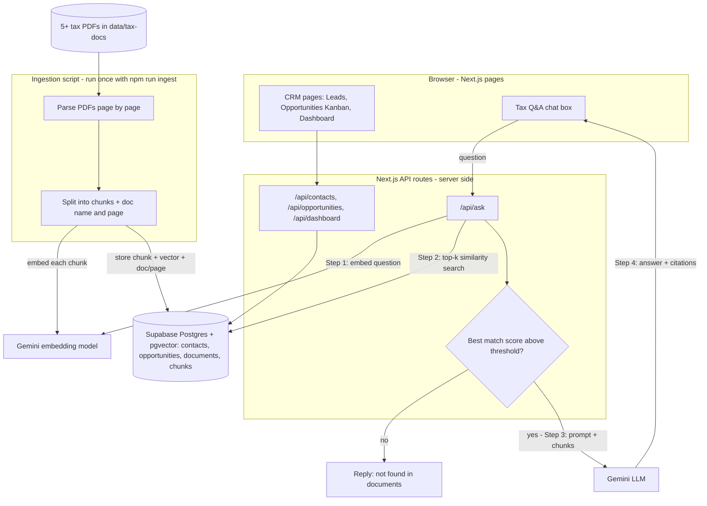
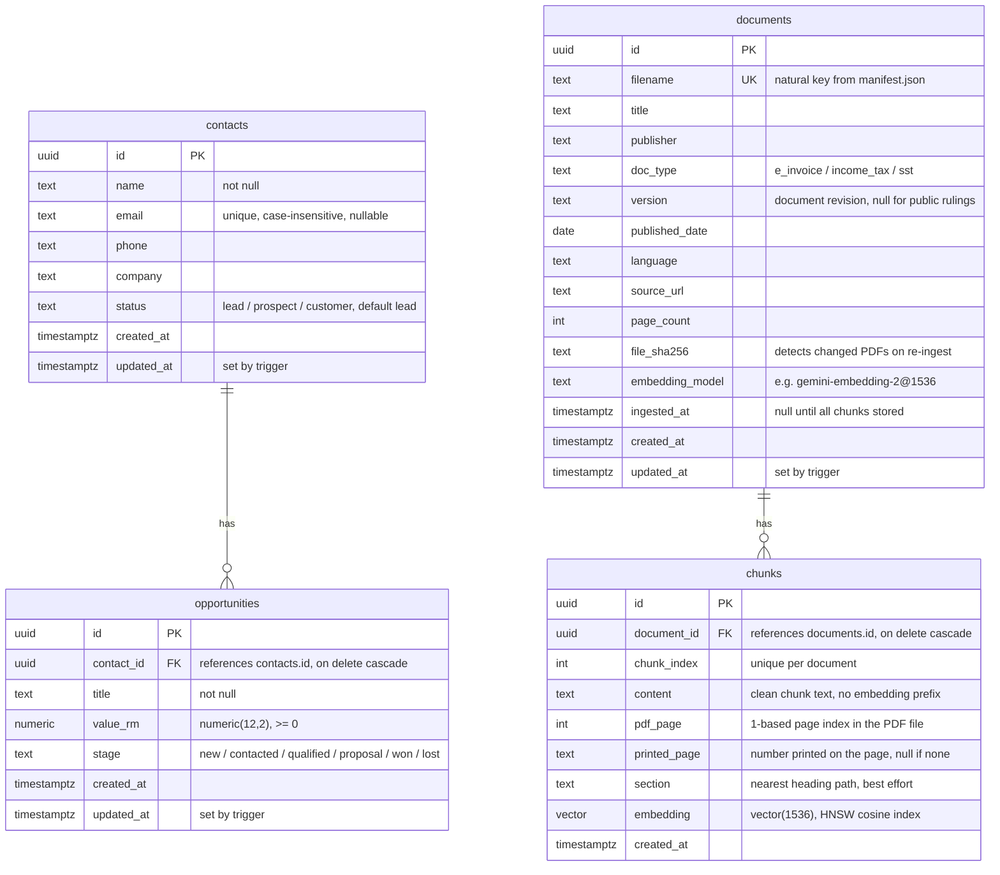

# Architecture

## System Design

## Data Model

- The brief uses 'Leads' and 'contacts' interchangeably; I model one contacts table where Lead/Prospect/Customer is the status field.
- Embedding dimension: 1536 (`gemini-embedding-2` with `outputDimensionality: 1536`). pgvector's HNSW index supports up to 2,000 dimensions on `vector`, so the 3072 default would not be indexable.
- Status and stage are `text` with `CHECK` constraints rather than Postgres enums, so adding a value is a one-line migration.
- Row Level Security is enabled on all four tables with no policies: the public API key can read nothing; the server uses the secret key, which bypasses RLS.
- Schema source of truth: `supabase/migrations/0001_init.sql`.

## RAG Design

### Document Parsing

TODO

### Chunking Strategy and Size

TODO

### Embedding Model

TODO

### Vector Store and Index

TODO

### Retrieval Settings (top-k, filters, reranking)

TODO

### Prompt Design

TODO

### Citation Approach

TODO

### Hallucination Guard

TODO

### Error Handling

TODO

## Stack Choice

TODO

## Evaluation Results

TODO

## What I Would Do Differently With More Time

TODO
