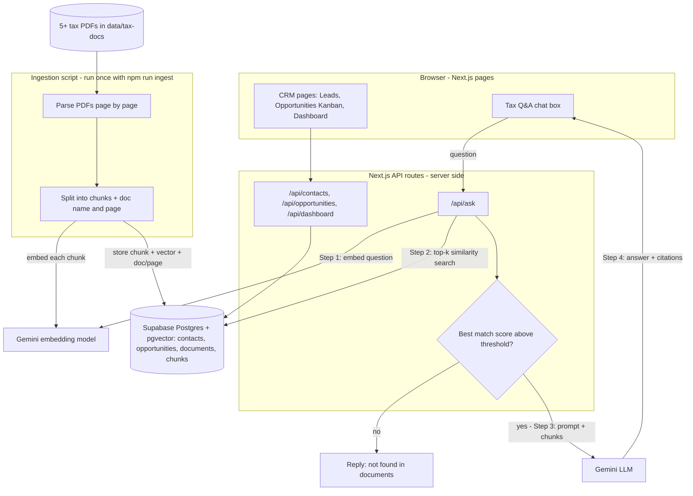
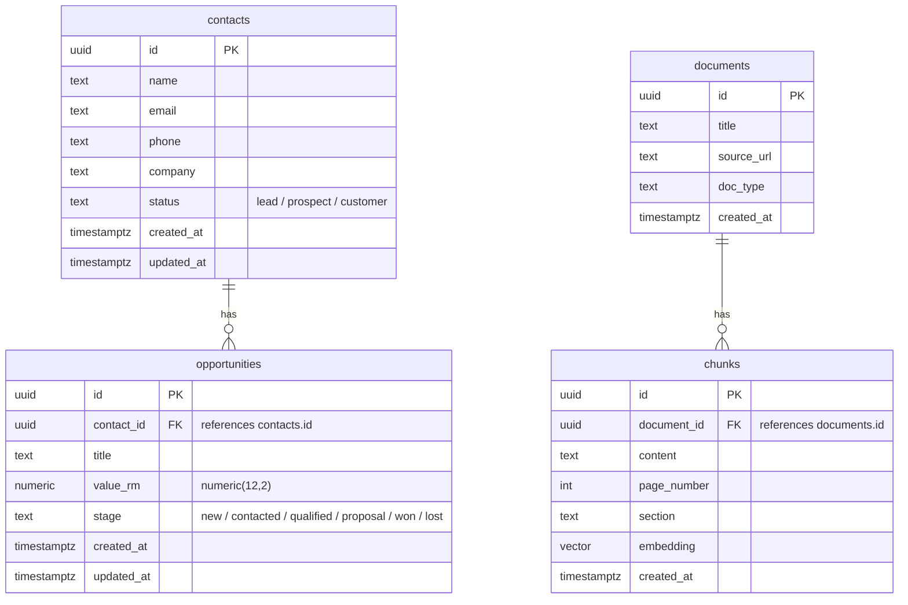

# Architecture

## System Design

## Data Model

- The brief uses 'Leads' and 'contacts' interchangeably; I model one contacts table where Lead/Prospect/Customer is the status field.
- Embedding dimension: TODO - must match the chosen Gemini embedding model.

## RAG Design

### Document Parsing

TODO

### Chunking Strategy and Size

TODO

### Embedding Model

TODO

### Vector Store and Index

TODO

### Retrieval Settings (top-k, filters, reranking)

TODO

### Prompt Design

TODO

### Citation Approach

TODO

### Hallucination Guard

TODO

### Error Handling

TODO

## Stack Choice

TODO

## Evaluation Results

TODO

## What I Would Do Differently With More Time

TODO
